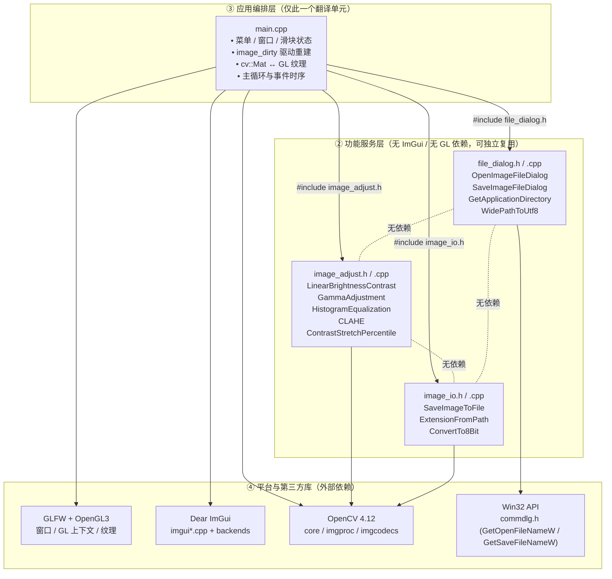
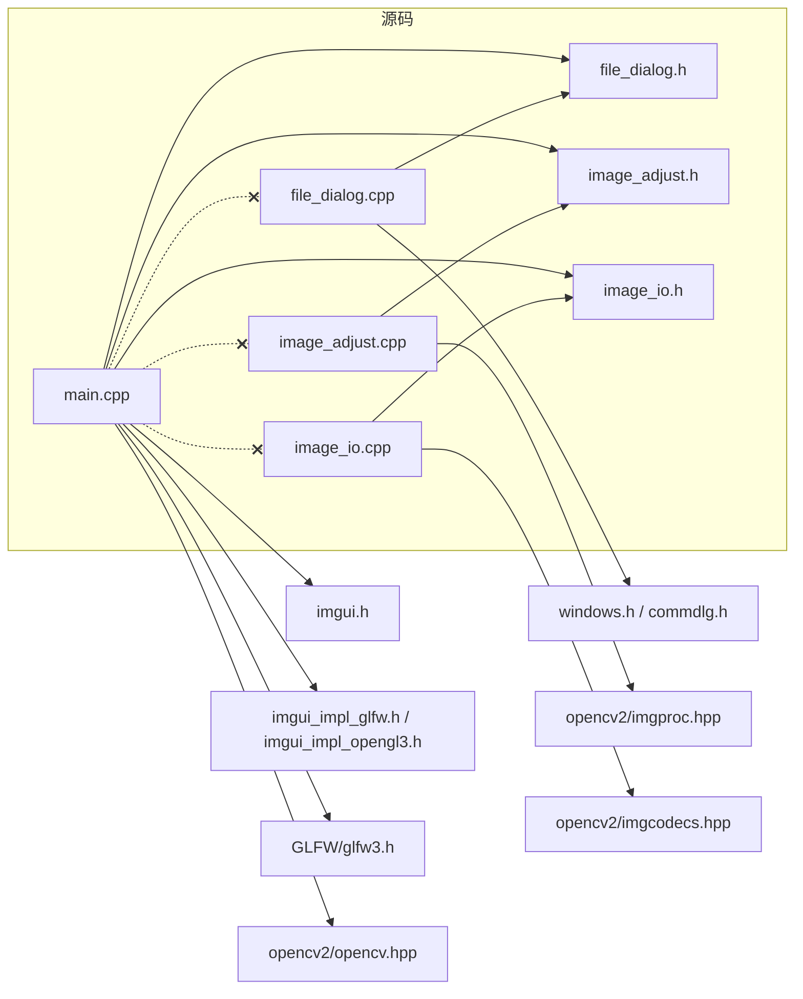
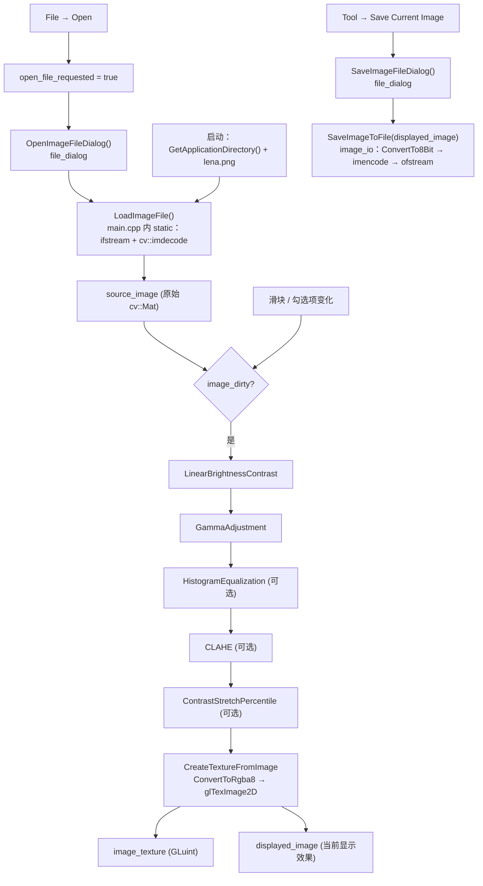

# image_test

基于 Dear ImGui（GLFW + OpenGL3）与 OpenCV 的图像查看与调整工具。

## 功能

- `File -> Open`：调用 Windows 原生对话框打开图像。
- `Tool -> Save Current Image`：将当前显示效果编码写盘（默认 PNG）。
- `Tool -> Reset Image`：重置全部调整参数。
- `Tool -> Brightness and Contrast Adjustment`：
  - `Linear Brightness and Contrast Adjustment`
  - `Gamma Adjustment`
  - `Histogram Equalization`
  - `CLAHE`
  - `Contrast Stretching`
- 启动时自动加载可执行文件同目录下的 `lena.png`，缺失则跳过。

## 模块架构

界面层（`main.cpp`）只负责 UI 状态与 GL 纹理生命周期；算法、对话框、写盘各自独立成文件，三者之间零横向依赖。

## 编译单元依赖

头文件只暴露函数声明，`.cpp` 中的辅助函数（`WideToUtf8`、`ExtensionFromPath`、`ConvertTo8Bit`）均为 `static`，不进入其他翻译单元。

## 运行时数据流

数据所有权：

| 变量 | 归属 | 含义 |
|---|---|---|
| `source_image` | `main.cpp` | 解码后的原始图，永不修改，是所有调整的输入 |
| `displayed_image` | `main.cpp` | 调整链末端结果，供保存使用（不是原始图） |
| `image_texture` | `main.cpp` → OpenGL | GPU 侧纹理，重建时先建新再删旧 |
| `image_dirty` | `main.cpp` | 唯一的“重算”触发信号，跨帧延迟重建 |

## 文件职责

| 文件 | 层 | 对外接口 | 内聚职责 | 依赖 |
|---|---|---|---|---|
| `main.cpp` | 编排/表现 | `main()` | 菜单与窗口、滑块状态、纹理生命周期、事件循环时序 | imgui、backends、GLFW、OpenCV |
| `file_dialog.h/.cpp` | 功能服务 | `OpenImageFileDialog`、`SaveImageFileDialog`、`GetApplicationDirectory`、`WidePathToUtf8` | Win32 原生对话框、宽字符路径转换、exe 目录定位 | `windows.h`、`commdlg.h` |
| `image_adjust.h/.cpp` | 功能服务 | 5 个 `cv::Mat → cv::Mat` 纯函数 | 全部像素运算（convertTo / pow / equalizeHist / createCLAHE / calcHist+LUT） | OpenCV `core`/`imgproc` |
| `image_io.h/.cpp` | 功能服务 | `SaveImageToFile` | 扩展名解析、位深归一、JPEG 去 alpha、imencode 写盘 | OpenCV `imgcodecs`/`imgproc`、`fstream` |

## 构建

项目提供 Visual Studio 工程 `example_glfw_opengl3.vcxproj`（MSVC v143，x64）以及 `Makefile` / `build_win32.bat`。

首次构建前需将工程属性中的 `OpenCV_DIR` 指向本机 OpenCV 4.12 的构建目录（当前为 `D:\opencv\4.12\opencv\build`），并确保 `opencv_world4120.dll` 与可执行文件同目录。

## 依赖

- Dear ImGui（仓库根目录）
- GLFW（`examples/libs/glfw`）
- OpenCV 4.12（`opencv_world4120`，x64/vc16）
- `comdlg32.lib`（原生打开 / 保存对话框）